# 사주경 · 월하몽

**꽃패 78장이 뒤집혀 있습니다. 딱 세 장만 고른다면, 어떤 패에 손이 갈까요?**

화선 낭자의 ‘마음의 길’에서는 첫 번째 패가 지나온 일을, 두 번째 패가 지금을, 마지막 패가 앞으로의 흐름을 들려줍니다. 그 옆방에는 생일을 들고 찾아가는 만월 아씨와 어젯밤 꿈 이야기를 기다리는 몽이 도령이 있습니다.

[시각화 도감 보기 ↓](#월하몽-시각화-도감)

<p align="center">
  <a href="front/media/characters/hwaseon_nangja.mp4"></a>
  <a href="_hwapae_deck.png">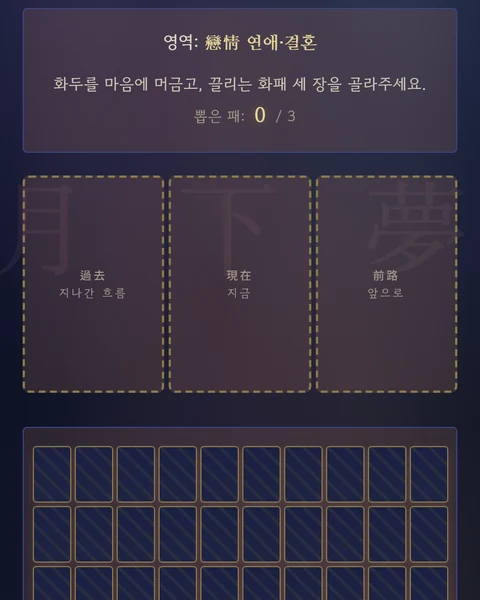</a>
  <a href="_webtoon_p3.png"></a>
</p>

<details>
<summary><strong>🂠 꽃패 세 장 뒤집기</strong> · 실제 결과 화면 펼쳐 보기</summary>

이 판의 첫 패는 <strong>도사(道士)</strong>입니다. 같은 패라도 어느 자리에 놓였는지에 따라 읽는 맥락이 달라집니다.


</details>

## 달 아래, 세 사람에게 건네는 세 가지

| 찾아갈 사람 | 건네는 것 | 돌아오는 것 |
| --- | --- | --- |
| **화선 낭자** | 내가 고른 꽃패 세 장 | 지나온 흐름부터 앞날까지, 패의 그림과 자리를 연결한 풀이 |
| **만월 아씨** | 태어난 날짜와 시각 | 연·월·일·시의 네 기둥을 바탕으로 풀어낸 내 사주 이야기 |
| **몽이 도령** | “어젯밤 꿈에 호랑이가 나왔어요” 같은 한 장면 | 꿈속 상징을 짚어 주는 해몽 |

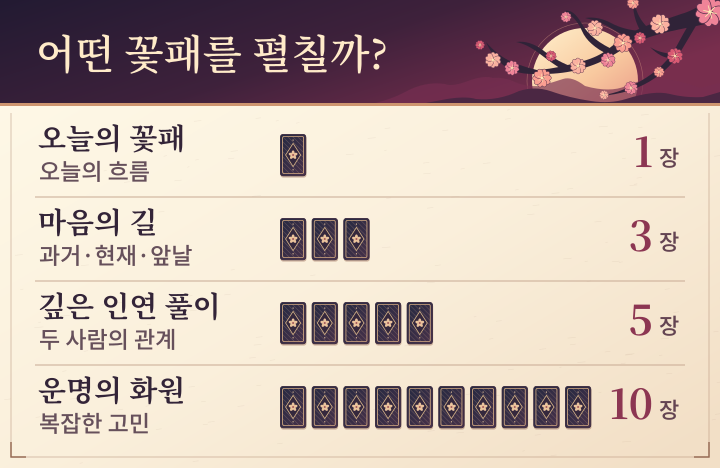

오늘 하루가 궁금하면 한 장을 고릅니다. 같은 고민을 과거·현재·앞날로 나누어 보고 싶으면 ‘마음의 길’로, 내 마음과 상대의 마음을 따로 읽고 싶으면 ‘깊은 인연 풀이’로 들어갑니다. [꽃패 메뉴와 각 자리의 뜻](front/js/readers/hwapae-reader.js)

## 생일 하나가 이야기로 바뀌는 과정

**2000년 1월 1일**을 넣으면 달력 엔진은 그날의 일주를 <strong>무오(戊午)</strong>로 계산합니다. 일주는 태어난 *날*을 나타내는 두 글자입니다. 사주경은 이렇게 계산한 값에 인물의 목소리와 그림을 더해, 같은 생일을 숫자로도 이야기로도 읽게 합니다.

### 사주의 어떤 부분을 보고 MBTI 네 축을 읽을까?

달력 엔진이 계산한 사주를 받아, 월하몽의 자체 규칙이 네 축의 경향을 각각 해석합니다. ‘일간’은 태어난 날을 나타내는 두 글자 중 첫 글자이고, ‘오행’은 목·화·토·금·수입니다.

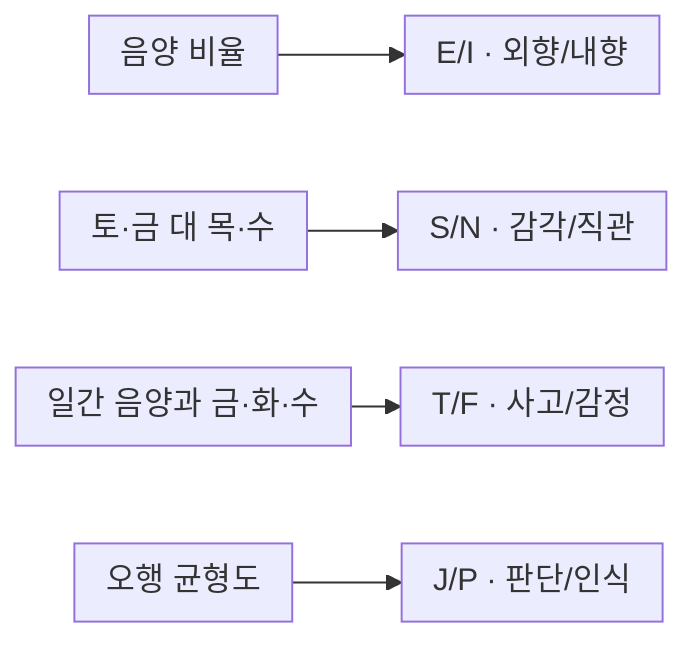

예를 들어 여덟 글자 중 양이 네 개면 양의 비율은 50%입니다. 이때 E/I 칸에는 **미정**이 남습니다. 모듈은 각 축에서 어떤 값이 판단의 근거였는지도 함께 돌려줍니다. [사주 달력 엔진](engine/saju/pillars.py) · [사주 × MBTI 모듈](engine/divination/saju_mbti/) · [화패 풀이 엔진](engine/divination/hwapae/)

## 내 컴퓨터에서 첫 장 열기

Python 3.12에서 다음 명령으로 시작합니다.

```sh
git clone https://github.com/Technoetic/saju-mbti-fusion.git
cd saju-mbti-fusion
python -m venv .venv
```

가상환경은 Windows PowerShell에서 `.\.venv\Scripts\Activate.ps1`, macOS·Linux에서는 `source .venv/bin/activate`로 엽니다.

```sh
python -m pip install -r requirements.txt
python -m uvicorn web.server:app --host 127.0.0.1 --port 8000
```

브라우저에서 `http://127.0.0.1:8000`을 열면 월하몽에 들어갑니다. 키 없이 첫 계산을 해보려면 `http://127.0.0.1:8000/api/saju/daily?date=2000-01-01`을 여세요. 응답의 `day_pillar.ganzhi_ko`에서 **무오**를 확인할 수 있습니다. 생성형 이야기 기능에 쓸 키는 [환경 설정 예시](.env.example)에 안내되어 있습니다.

## 월하몽 시각화 도감

꽃패를 고르는 화면부터 달력 엔진까지, 궁금한 질문을 펼쳐 보세요. 본문의 [꽃패 장수 그림](#달-아래-세-사람에게-건네는-세-가지)은 D3로, [MBTI 네 축의 흐름](#사주의-어떤-부분을-보고-mbti-네-축을-읽을까)은 Mermaid로 그렸습니다. 아래에서는 나머지 23개 도구의 결과를 볼 수 있습니다.

<details>
<summary><strong>꽃패 78장 중 무엇을 뽑을까?</strong></summary>

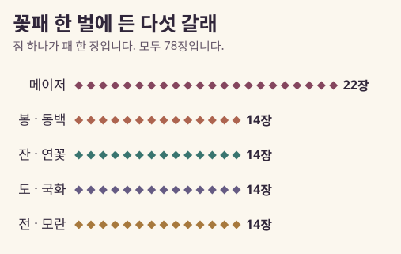

**Vega-Lite** · 점 하나가 꽃패 한 장입니다. 78장 중 메이저는 22장이고, 나머지 56장은 네 무늬에 14장씩 나뉩니다.

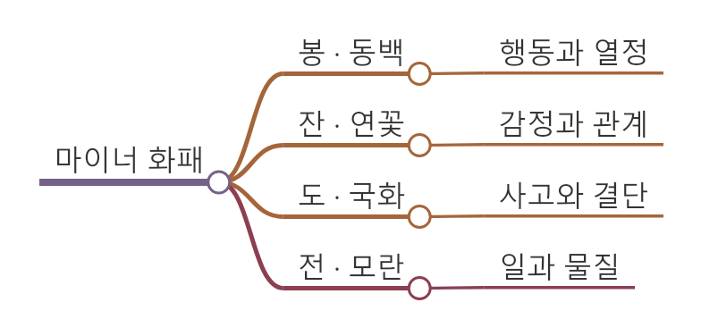

**markmap** · 화패 속 꽃은 무늬를 읽는 단서입니다. 연꽃이 핀 ‘잔’은 감정과 관계로, 국화가 핀 ‘도’는 사고와 결단으로 이어집니다.

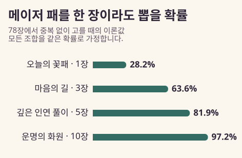

**Altair** · 한 장이라면 메이저를 만날 확률은 28.2%, 세 장이라면 63.6%입니다. 모든 패가 같은 확률로 뽑히고 한 번 뽑은 패는 되돌리지 않는다고 가정한 이론값입니다.

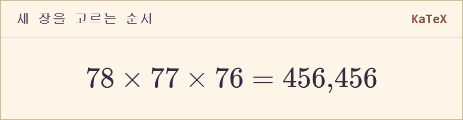

**KaTeX** · ‘마음의 길’에서는 첫 패가 과거, 둘째가 현재, 셋째가 앞날입니다. 세 자리의 순서를 구분하면 `78 × 77 × 76 = 456,456`가지로 펼칠 수 있습니다.

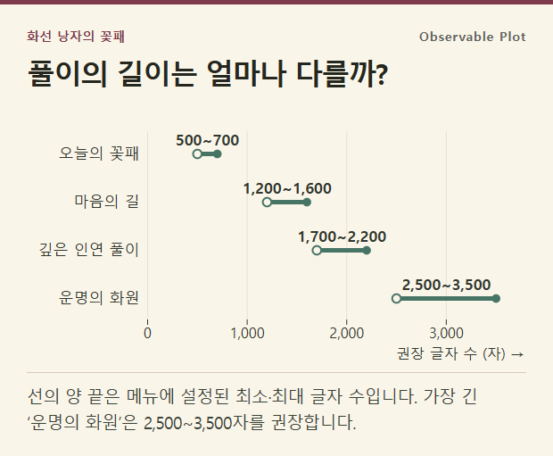

**Observable Plot** · 선의 양 끝은 메뉴에 설정된 권장 글자 수입니다. 오늘의 꽃패에는 짧은 메시지를, 운명의 화원에는 긴 풀이를 요청합니다. [메뉴 설정](front/js/readers/hwapae-reader.js)

</details>

<details>
<summary><strong>달력은 생일·시각·출생지를 어떻게 읽을까?</strong></summary>

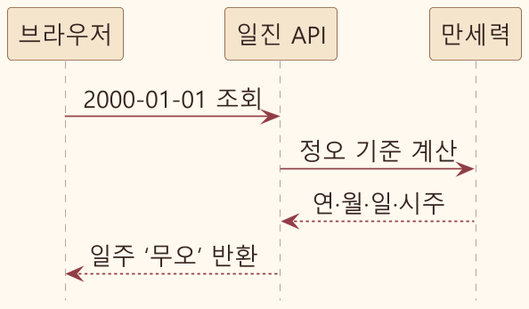

**PlantUML** · `2000-01-01`로 일진을 조회하면 API는 정오를 기준으로 만세력을 호출하고, 브라우저에 일주 ‘무오’를 돌려줍니다. [도식 원본](docs/readme/atlas/structure/daily-request.puml)

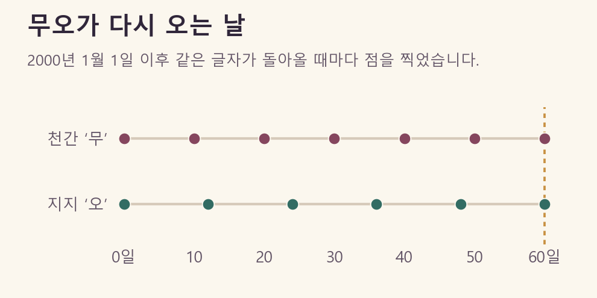

**Matplotlib** · 첫 글자는 10일, 둘째 글자는 12일마다 돌아옵니다. 두 글자가 동시에 ‘무오’로 돌아오는 날은 60일 뒤인 2000년 3월 1일입니다.

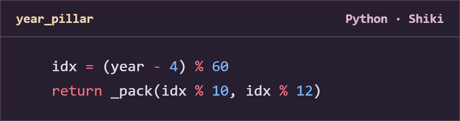

**Shiki** · 연주를 계산하는 두 줄입니다. `idx = (year - 4) % 60`으로 순번을 구하고, `return _pack(idx % 10, idx % 12)`로 두 글자를 고릅니다. [복사 가능한 Python 원문](engine/saju/pillars.py)

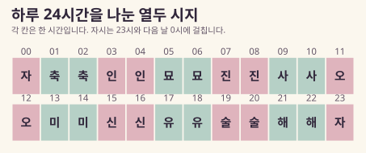

**ggplot2** · 하루를 두 시간씩 묶으면 열두 시지가 됩니다. 23시와 0시는 날짜 경계를 사이에 두고 같은 자시(子時)에 속합니다.

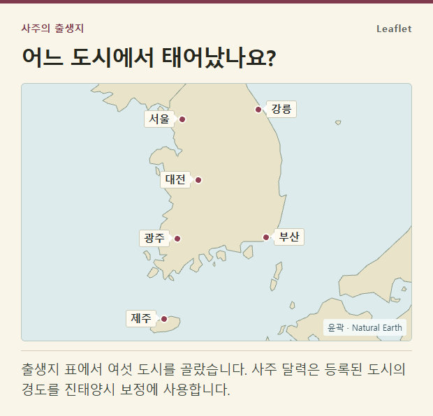

**Leaflet** · 앱은 출생지 이름에 대응하는 경도를 시간 보정에 씁니다. 지도는 좌표표에서 고른 여섯 도시를 보여줍니다. [출생지 좌표표](engine/saju/geo_lut.py)

</details>

<details>
<summary><strong>‘무오’ 두 글자에서 토와 화는 어떻게 나올까?</strong></summary>

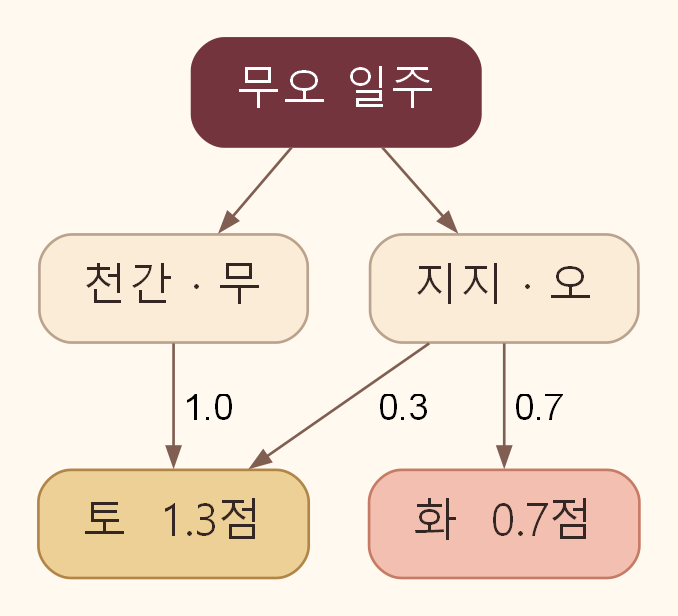

**Graphviz** · 천간 ‘무’가 토에 1점을 보탭니다. 지지 ‘오’의 몫까지 합치면 무오 한 기둥의 결과는 토 1.3점, 화 0.7점입니다. [도식 원본](docs/readme/atlas/structure/pillar-elements.dot)

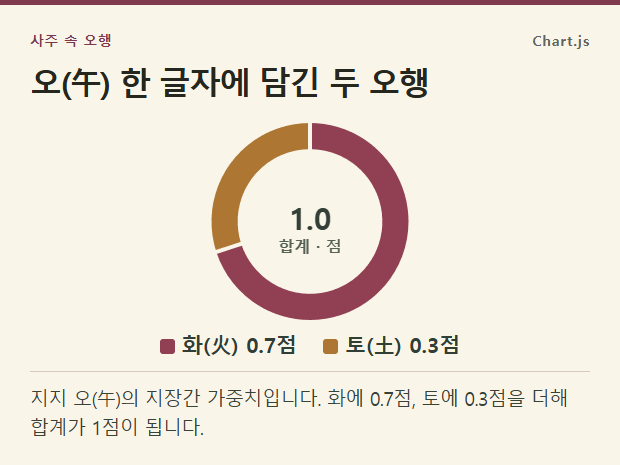

**Chart.js** · 둘째 글자 ‘오’만 확대하면 한 글자의 1점이 화 70%, 토 30%로 나뉩니다. [앱의 오행 가중치](engine/saju/wuxing.py)

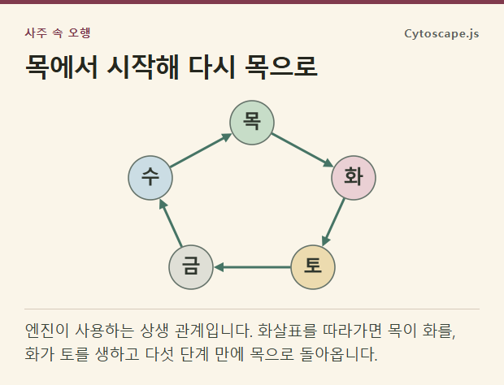

**Cytoscape.js** · 오행을 관계로 읽을 때는 화살표를 따라갑니다. 앱의 상생 규칙에서 목은 화를 돕고, 다섯 화살표를 모두 지나면 다시 목에 닿습니다. [상생 규칙](engine/saju/compat.py)

</details>

<details>
<summary><strong>사주 × MBTI에서 ‘미정’은 언제 나올까?</strong></summary>

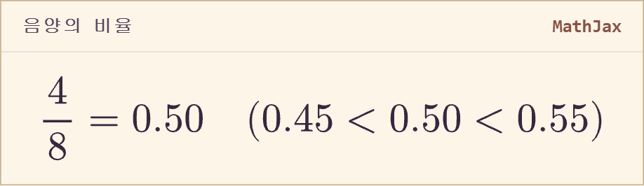

**MathJax** · 양이 네 개면 `4 ÷ 8 = 0.50`입니다. E/I 규칙의 두 경계 사이에 있어 이 축은 미정으로 남습니다.

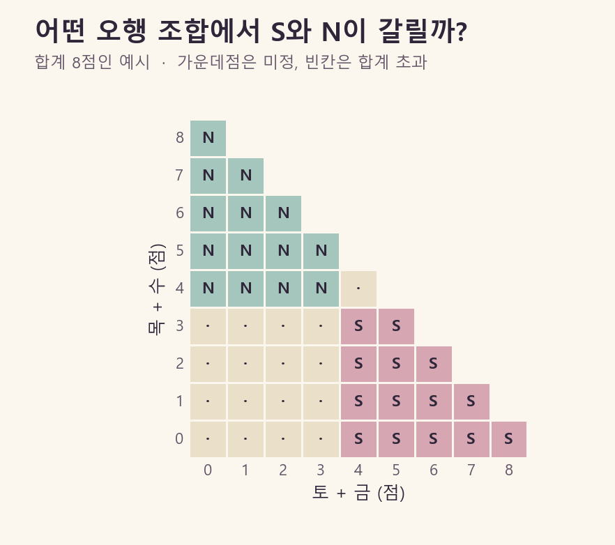

**seaborn** · 토·금을 합한 점수와 목·수를 합한 점수를 한 칸씩 바꿔 본 예시입니다. 두 그룹에 넣지 않은 점수는 화에 배정했습니다. 색은 월하몽 S/N 함수의 반환값입니다.

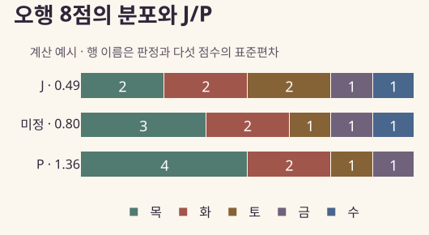

**Plotly** · 합계가 8점으로 같아도 고르게 퍼진 사례는 J, 한쪽에 몰린 사례는 P를 반환합니다. 중간 사례는 미정입니다. [네 축의 계산 규칙](engine/divination/saju_mbti/predictor.py)

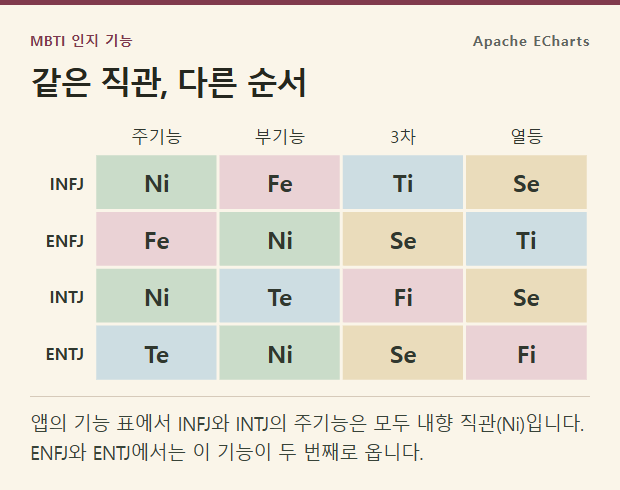

**Apache ECharts** · MBTI 유형을 입력받는 별도 모듈에는 유형별 기능 순서가 있습니다. 같은 N을 가진 네 유형을 골라, 각각 어떤 기능을 첫자리에 놓는지 비교했습니다. [유형별 기능표](engine/saju/mbti_functions.py)

</details>

<details>
<summary><strong>화면에서 패를 눌렀을 때, 앱 안에서는?</strong></summary>

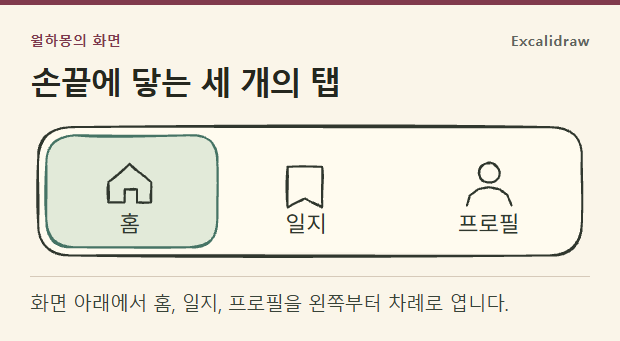

**Excalidraw** · 화면 아래의 세 탭은 홈·일지·프로필입니다. 앱의 하단 탐색 영역을 손그림으로 옮겼습니다. [화면 원본](front/index.html)

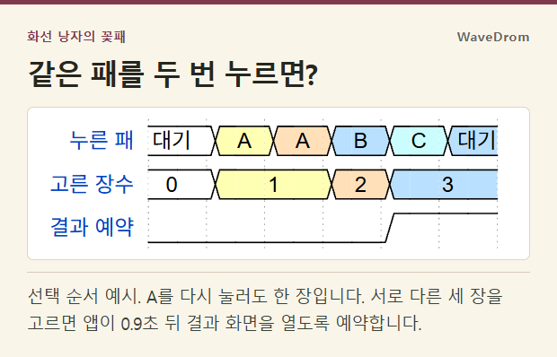

**WaveDrom** · 같은 패 A를 연달아 눌러도 선택한 패는 한 장입니다. 예시의 클릭과 장수 변화를 위아래로 맞춰 보면 두 번째 클릭에서 차이가 드러납니다.

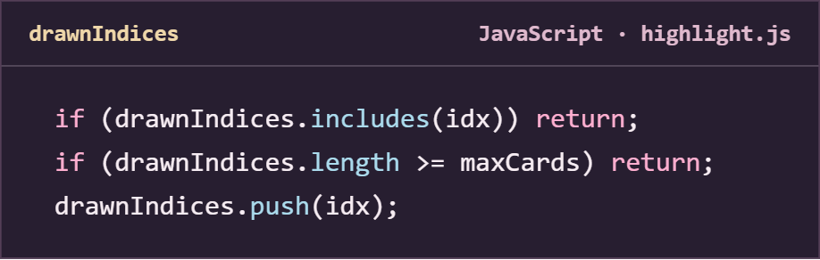

**highlight.js** · 방금 본 동작의 원문입니다. 이미 고른 번호면 돌아가고, 자리가 남아 있을 때만 목록에 넣습니다. [복사 가능한 JavaScript 원문](front/js/readers/hwapae-reader.js)

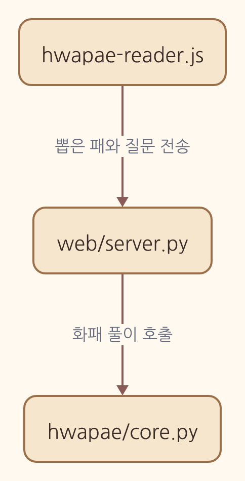

**D2** · 선택이 끝나면 화면이 뽑은 패와 질문을 서버에 전달합니다. 각 상자의 파일을 따라가면 요청을 받는 곳과 풀이를 호출하는 곳을 찾을 수 있습니다. [도식 원본](docs/readme/atlas/structure/flower-reading.d2)

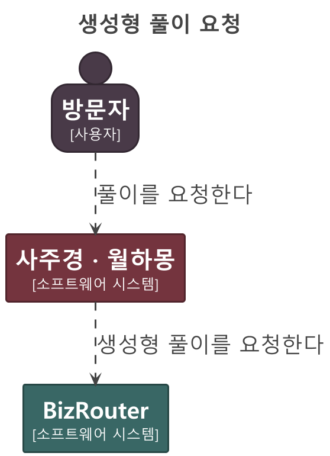

**Structurizr** · 한 걸음 물러서 보면 방문자는 월하몽에 풀이를 요청하고, 생성형 이야기가 필요한 경로에서는 월하몽이 BizRouter를 호출합니다. [시스템 구성 원본](docs/readme/atlas/structure/story-context.dsl)

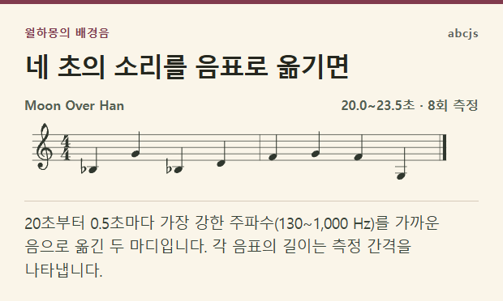

**abcjs** · 월하몽에서 들리는 배경음의 20초 지점부터 0.5초마다 대표음 하나를 골랐습니다. 여덟 음표의 간격은 분석 시점에 맞췄습니다. [원곡 Moon Over Han](front/media/bg/Moon%20Over%20Han.wav)

</details>
